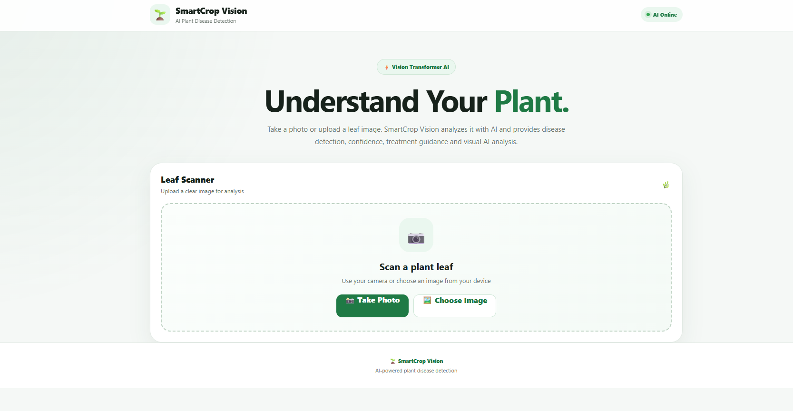
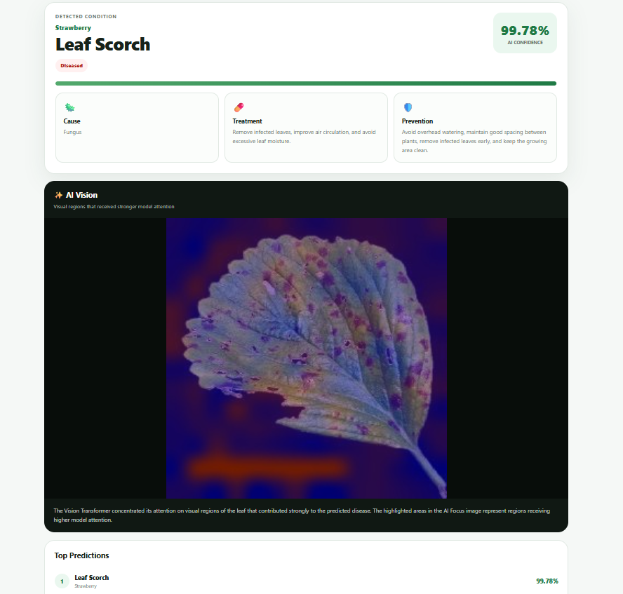

# 🌱 SmartCrop Vision

SmartCrop Vision is a plant disease detection project I built to explore how a computer vision model can be turned into a complete working application.

The idea is simple: upload a picture of a plant leaf, and the system analyzes it using a Vision Transformer and predicts the most likely disease. The application also provides the confidence score, health status, severity, treatment information, prevention tips, and an AI attention visualization.

---

## 🚀 What I Built

Instead of keeping the project as only a trained ML model, I built the complete pipeline around it:

* Plant disease classification using a Vision Transformer
* Image preprocessing and model inference
* FastAPI backend for serving predictions
* Web interface for uploading leaf images
* Confidence and severity information
* Disease treatment and prevention information
* AI attention visualization
* Dockerized backend
* Responsive web interface

---

## 🔄 Application Flow

```text
                    ┌───────────────────┐
                    │   User uploads    │
                    │    leaf image     │
                    └─────────┬─────────┘
                              │
                              ▼
                    ┌───────────────────┐
                    │ Image Validation  │
                    │  & Preprocessing  │
                    └─────────┬─────────┘
                              │
                              ▼
                    ┌───────────────────┐
                    │ Vision Transformer│
                    │      Model        │
                    └─────────┬─────────┘
                              │
                              ▼
                    ┌───────────────────┐
                    │ Disease Prediction│
                    │   & Confidence    │
                    └─────────┬─────────┘
                              │
                 ┌────────────┼────────────┐
                 │            │            │
                 ▼            ▼            ▼
          ┌────────────┐ ┌──────────┐ ┌──────────────┐
          │   Health   │ │ Severity │ │ AI Attention │
          │   Status   │ │  Level   │ │ Visualization│
          └─────┬──────┘ └────┬─────┘ └──────┬───────┘
                │             │              │
                └─────────────┼──────────────┘
                              ▼
                    ┌───────────────────┐
                    │ Disease Details   │
                    │ Treatment &       │
                    │ Prevention        │
                    └─────────┬─────────┘
                              │
                              ▼
                    ┌───────────────────┐
                    │    Web UI Result  │
                    └───────────────────┘
```

---

## 🏗️ System Architecture

```text
┌──────────────────────────────────────────────────────────────┐
│                           USER                               │
│                                                              │
│                  Uploads Plant Leaf Image                    │
└────────────────────────────┬─────────────────────────────────┘
                             │
                             │ HTTP Request
                             ▼
┌──────────────────────────────────────────────────────────────┐
│                        FRONTEND                              │
│                                                              │
│                    HTML / CSS / JavaScript                   │
│                                                              │
│  • Image Upload                                               │
│  • Loading State                                               │
│  • Prediction Results                                          │
│  • Confidence                                                  │
│  • Disease Information                                         │
│  • Treatment / Prevention                                      │
│  • AI Attention Visualization                                  │
└────────────────────────────┬─────────────────────────────────┘
                             │
                             │ POST /predict
                             ▼
┌──────────────────────────────────────────────────────────────┐
│                     FASTAPI BACKEND                           │
│                                                              │
│                       src/predict.py                          │
│                                                              │
│  • Receives image                                             │
│  • Validates input                                            │
│  • Preprocesses image                                         │
│  • Runs model inference                                       │
│  • Processes prediction                                       │
│  • Builds API response                                        │
└────────────────────────────┬─────────────────────────────────┘
                             │
                             ▼
┌──────────────────────────────────────────────────────────────┐
│                  MACHINE LEARNING LAYER                       │
│                                                              │
│                  Vision Transformer (ViT)                     │
│                                                              │
│       Image → Features → Classification → Probabilities      │
│                                                              │
│  • Disease Classification                                     │
│  • Confidence Scores                                           │
│  • Top Predictions                                             │
│  • Attention Information                                       │
└────────────────────────────┬─────────────────────────────────┘
                             │
                             ▼
┌──────────────────────────────────────────────────────────────┐
│                    RESULT PROCESSING                           │
│                                                              │
│ Prediction → Disease Info → Severity → Treatment              │
│                              ↓                               │
│                          Prevention                            │
└────────────────────────────┬─────────────────────────────────┘
                             │
                             ▼
┌──────────────────────────────────────────────────────────────┐
│                         WEB UI                                │
│                                                              │
│                    Plant Health Report                        │
└──────────────────────────────────────────────────────────────┘
```

---

## 🧠 Machine Learning

The core of SmartCrop Vision is a **Vision Transformer (ViT)** used for plant disease image classification.

The model takes a processed leaf image and predicts the most likely disease class.

The inference pipeline is:

```text
Input Image
     ↓
Image Preprocessing
     ↓
Vision Transformer
     ↓
Class Probabilities
     ↓
Top Predictions
     ↓
Disease Information
```

The model output is then combined with application-level information such as disease severity, treatment, and prevention guidance before being returned to the frontend.

---

## 🔬 Example Prediction

One of my test predictions produced:

```text
Plant       : Strawberry
Disease     : Leaf Scorch
Confidence  : 99.78%
Severity    : High
Status      : Diseased
```

The application also displays:

* Disease description
* Possible cause
* Treatment
* Prevention
* AI attention visualization
* Alternative predictions

---

## 🌐 Web Interface

The frontend was designed to make the model easy to use instead of requiring users to interact directly with the API.

The workflow from the user's perspective is:

```text
Upload Image
     ↓
Analyze with AI
     ↓
AI Processing
     ↓
Plant Health Report
     ↓
Disease + Confidence
     ↓
Treatment + Prevention
     ↓
AI Attention
```

The interface is responsive so that it can also be used on smaller screens.

---

## 📸 Screenshots

### Home Interface



### Prediction Result and AI Attention



---

## 🎥 Demo

I recorded a short demo showing the complete workflow:

**Upload Leaf → AI Analysis → Disease Prediction → Treatment Information → AI Attention**

*Add the demo video link here.*

---

## 🚀 FastAPI Backend

The trained model is exposed through a FastAPI REST API.

### Prediction Endpoint

```text
POST /predict
```

### Example Request

```bash
curl -X POST "http://localhost:8000/predict" \
  -F "file=@test.jpg"
```

The API receives the image, runs the model, processes the prediction, and returns the information required by the frontend.

---

## 🐳 Docker

I also containerized the backend using Docker so that the application can be run in a consistent environment.

### Build

```bash
docker build -t smartcrop-vision .
```

### Run

```bash
docker run --rm -p 8000:8000 smartcrop-vision
```

The API will be available at:

```text
http://localhost:8000
```

---

## 🛠️ Tech Stack

| Technology                | Used For                 |
| ------------------------- | ------------------------ |
| Python                    | ML and backend           |
| PyTorch                   | Deep learning            |
| Hugging Face Transformers | Vision Transformer       |
| FastAPI                   | REST API                 |
| Pillow                    | Image processing         |
| Matplotlib                | Visualization            |
| HTML                      | Frontend                 |
| CSS                       | UI and responsive design |
| JavaScript                | Frontend interaction     |
| Docker                    | Containerization         |
| Git & GitHub              | Version control          |

---

## 📂 Project Structure

```text
smartcrop-vision/
│
├── app/
│   └── index.html
│
├── src/
│   ├── predict.py
│   ├── train.py
│   ├── evaluate.py
│   ├── dataset.py
│   ├── data_loader.py
│   ├── gradcam.py
│   └── analyze_errors.py
│
├── screenshots/
│   ├── home.png
│   └── prediction.png
│
├── Dockerfile
├── .dockerignore
├── .gitignore
├── requirements.txt
├── requirements-deploy.txt
└── README.md
```

---

## 💻 Running Locally

### 1. Clone the repository

```bash
git clone https://github.com/loki25590/smartcrop-vision.git
cd smartcrop-vision
```

### 2. Create a virtual environment

```bash
python3 -m venv .venv
source .venv/bin/activate
```

### 3. Install dependencies

```bash
pip install -r requirements.txt
```

### 4. Start FastAPI

```bash
uvicorn src.predict:app --host 0.0.0.0 --port 8000
```

---

## ⚠️ Limitations

The model's prediction depends on the quality of the uploaded image and how similar the image is to the training data.

Real-world field conditions can be different from the images used during training.

For this reason, the system should be considered an **AI-assisted tool** rather than a replacement for professional agricultural diagnosis.

---

## 🔮 Future Improvements

Some improvements I would like to work on next:

* Support more crops and disease classes
* Improve model accuracy
* Improve confidence calibration
* GPU-based inference
* Public cloud deployment
* Dedicated mobile application
* Weather-based disease risk prediction
* Better model explainability

---

## 📚 What I Learned

This project helped me understand that building an ML application is more than just training a model.

While working on SmartCrop Vision, I got hands-on experience with:

* Vision Transformer inference
* Image preprocessing
* FastAPI
* Frontend/backend integration
* Docker
* Model output processing
* AI visualization
* Debugging and deployment

The biggest lesson for me was connecting the different parts together:

```text
Machine Learning
       +
Backend API
       +
Frontend
       +
Docker
       =
Complete ML Application
```

---

## 👨‍💻 Author

**Lokesh Reddy**

B.Tech Student | Machine Learning & AI

GitHub: https://github.com/loki25590

---

⭐ If you find SmartCrop Vision interesting, feel free to explore the project.
